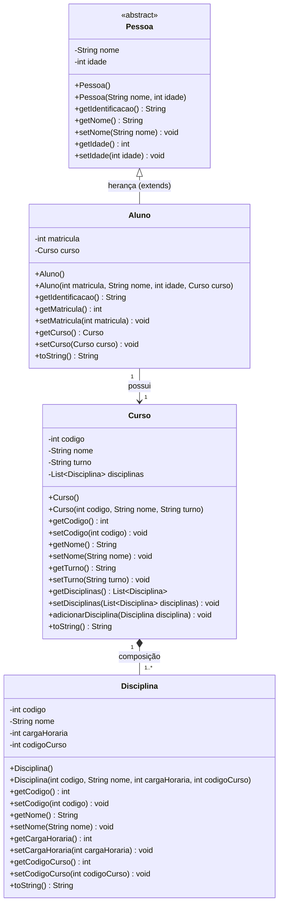
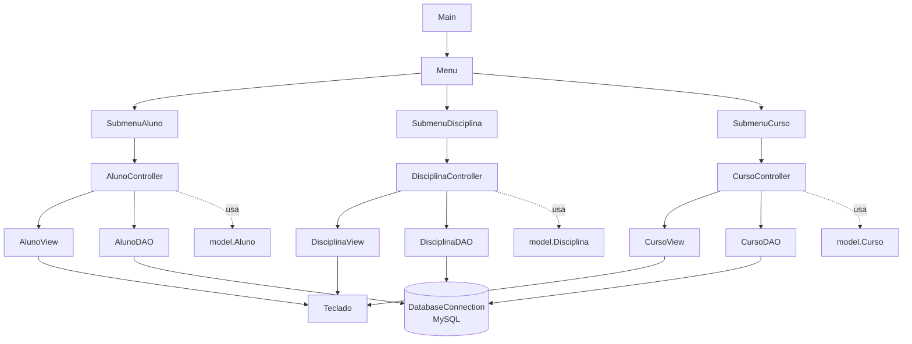
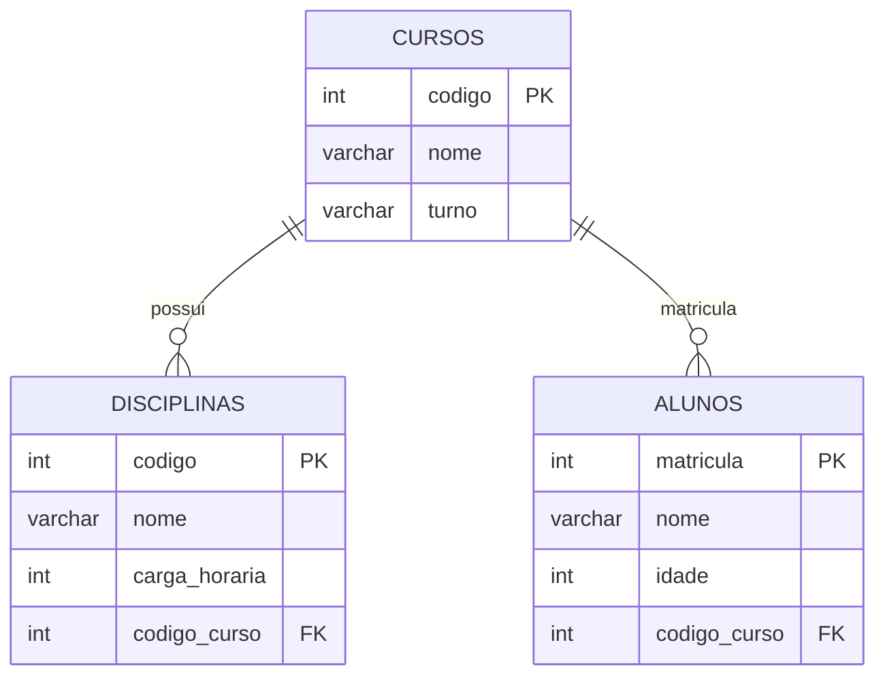

# Atividade 1 — Diagrama de Classes

> **Para imprimir/entregar:** `diagrama-de-classes.svg` e `diagrama-de-camadas.svg` (nesta pasta),
> ou a versão em Word em `word/1 - Diagrama de Classes.docx`, que já traz as duas imagens.
> O código Mermaid abaixo é a versão editável, caso você queira ajustar algo.

---

## 1. Modelo de domínio (as classes do negócio)

### Como ler os três relacionamentos

| Notação | Relacionamento | O que significa no trabalho |
|---|---|---|
| Triângulo vazado `<\|--` | **Herança** | `Aluno extends Pessoa`. O aluno herda `nome` e `idade`. |
| Seta simples `-->` | **Associação** | Todo aluno possui exatamente 1 curso (item c do enunciado). |
| Losango preenchido `*--` | **Composição** | O curso é dono das disciplinas: tem de 1 a N, e se o curso é removido elas vão junto (item d). |

---

## 2. Arquitetura em camadas (como as classes se organizam)

**Regra que vale para todo o sistema:**

- **Menu/Submenu** só encaminham a opção escolhida. Não sabem o que é banco de dados.
- **Controller** aplica a regra de negócio. Não tem `System.out.println` nem SQL.
- **View** só fala com o usuário (imprime e lê teclado). Não acessa banco.
- **DAO** é a única camada que conhece SQL.
- **Model** são os objetos do negócio, usados por todas as camadas.

---

## 3. Modelo do banco de dados

As chaves estrangeiras `codigo_curso` são o que o banco usa para garantir, por conta própria, que nenhum aluno e nenhuma disciplina fiquem sem curso.
